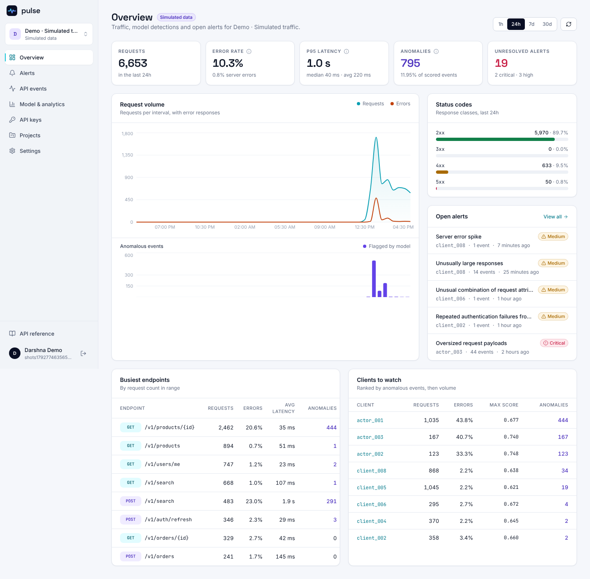
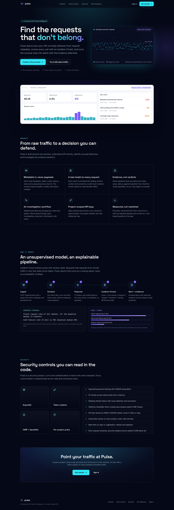
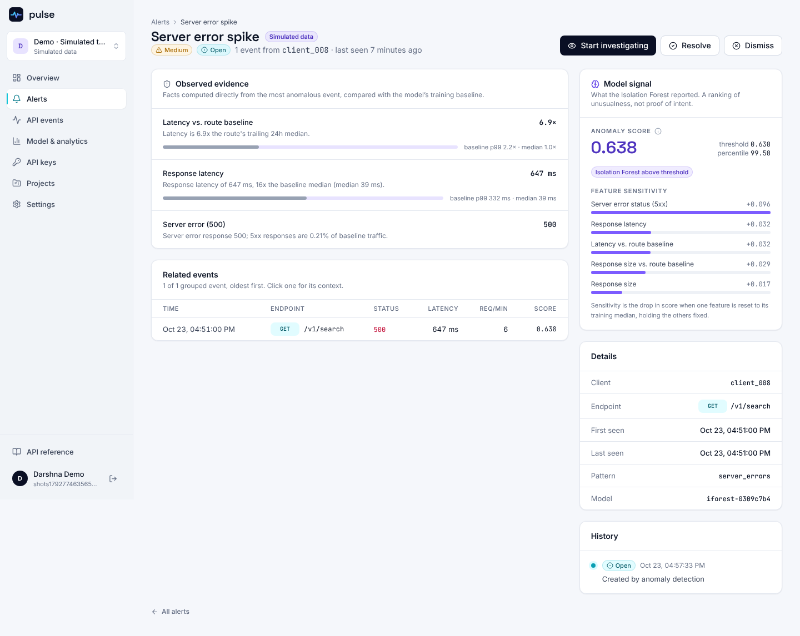
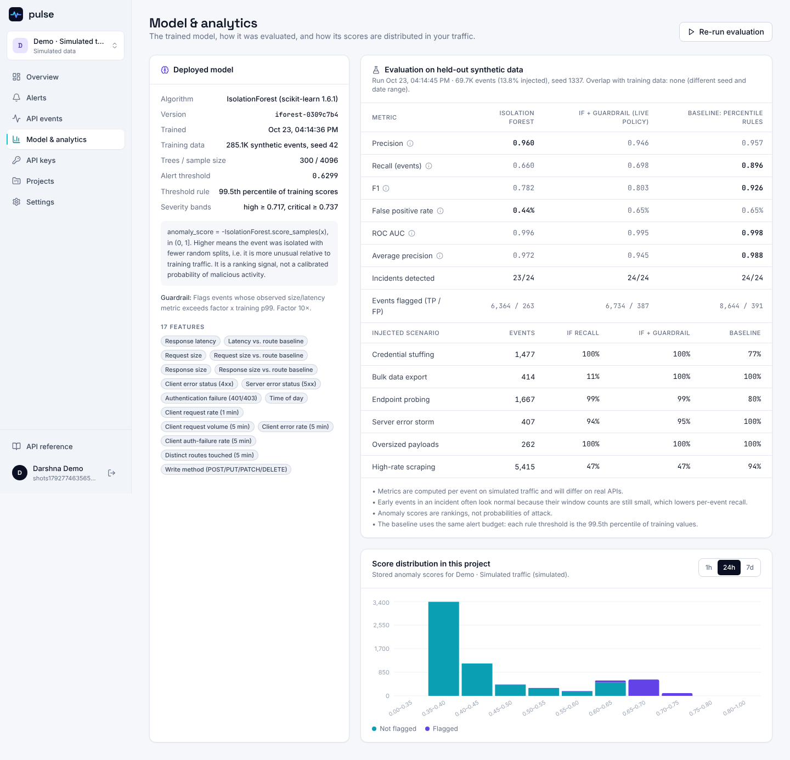

# Pulse

**AI-powered API threat intelligence.** Pulse ingests API request metadata, enriches each request with sliding-window context, scores it with an Isolation Forest, and groups unusual requests into alerts that show the observed evidence next to the model's signal.



| Landing | Alert detail | Model & analytics |
| --- | --- | --- |
|  |  |  |

All screenshots show the demo project, which contains clearly labelled simulated traffic.

---

## Contents

- [What is implemented](#what-is-implemented)
- [Architecture](#architecture)
- [Quick start](#quick-start)
- [Configuration](#configuration)
- [Sending events](#sending-events)
- [The ML model](#the-ml-model)
- [Security](#security)
- [Testing](#testing)
- [Project layout](#project-layout)
- [Limitations and next steps](#limitations-and-next-steps)
- [Troubleshooting](#troubleshooting)

## What is implemented

| Area | Status |
| --- | --- |
| Accounts: registration, sign-in, sign-out, session list, revoke one or all other sessions, password change | Done |
| Projects with ownership checks; cascading delete | Done |
| Project-scoped API keys: shown once, HMAC-hashed at rest, last-used tracking, revocation, per-key rate limit | Done |
| Ingestion `POST /api/v1/ingest/events`: strict schema, batches of up to 100, idempotency ids | Done |
| Context features computed from MongoDB (per-client windows, per-route baselines) | Done |
| ML service (FastAPI + scikit-learn Isolation Forest): `/health`, `/predict`, `/model/info`, evaluation | Done |
| Persisted events, predictions, explanations; retry of events scored while the ML service was down | Done |
| Alerts grouped by client and pattern, lifecycle open, investigating, resolved, dismissed, with notes and history | Done |
| Analytics computed with MongoDB aggregations (traffic, errors, latency percentiles, endpoints, clients, score distribution) | Done |
| Evaluation against a separate labelled dataset, compared with a rule-based baseline, shown in the app | Done |
| Demo project generator (development only, labelled as simulated everywhere) | Done |
| Versioned REST API `/api/v1` with OpenAPI 3 spec and Swagger UI at `/api/v1/docs` | Done |
| Web app: landing, register, login, overview, projects, events, alerts, alert detail, model & analytics, API keys, settings | Done |
| Docker Compose stack, GitHub Actions CI, end-to-end script | Done |
| Email verification, password reset, MFA, organisations or teams, retraining on customer traffic | Not implemented |

## Architecture

```
            Browser (React SPA)                     Your API or gateway
                   │  Bearer access token                 │  X-Pulse-Key
                   │  + HttpOnly refresh cookie           │
                   ▼                                      ▼
        ┌────────────────────────────────────────────────────────────┐
        │  Node API  (Express 5, TypeScript)                /api/v1    │
        │  auth · projects · keys · ingestion · alerts · analytics    │
        │                                                              │
        │  ingest → validate (Zod) → store → context features ─────┐  │
        │                         ▲                                 │  │
        │        alerts ◄── group anomalies ◄── predictions ◄───────┼──┼──┐
        └─────────────────────────┬─────────────────────────────────┘  │  │
                                  │ Mongoose                           │  │ X-Internal-Token
                                  ▼                                    ▼  │
                         ┌─────────────────┐          ┌──────────────────────────┐
                         │  MongoDB ≥ 7.0  │          │  ML service (FastAPI)    │
                         │  users, sessions│          │  features → IsolationForest
                         │  keys, events,  │          │  → evidence, sensitivity │
                         │  alerts         │          │  model.joblib + metadata │
                         └─────────────────┘          └──────────────────────────┘
```

- **apps/web**: React 18, Vite, Tailwind, Framer Motion, Recharts, TanStack Query, React Router 7. Dark marketing and auth pages; light dashboard.
- **apps/api**: Express 5, Mongoose 8, Zod, argon2, jsonwebtoken, helmet, express-rate-limit, pino.
- **services/ml**: Python 3.13, scikit-learn 1.6, pandas, FastAPI, joblib.
- The API computes context features from MongoDB and sends them with each event to the ML service, which is stateless apart from the model artifact. The same feature logic is implemented in Python for training, and a shared fixture (`services/ml/tests/fixtures/context_parity.json`) is checked by both test suites so the two implementations cannot drift apart.

## Quick start

### Option A: Docker Compose

```bash
cp .env.example .env
# Fill in JWT_ACCESS_SECRET, API_KEY_PEPPER and ML_SERVICE_TOKEN with random values:
node -e "console.log(require('crypto').randomBytes(48).toString('base64url'))"
docker compose up --build
open http://localhost:8080
```

The ML image trains and evaluates the default model at build time (about 30 seconds). Nginx serves the SPA and proxies `/api` to the API, so the browser sees one origin. The compose file serves plain HTTP on localhost and sets `COOKIE_SECURE=false`; put it behind TLS and remove that line before exposing it anywhere.

### Option B: Local processes

Requirements: Node.js 22 (`.nvmrc`, ≥ 20.11 works), Python 3.13 (3.11+ should work), MongoDB **7.0 or newer** (the analytics use `$median` and `$percentile`).

```bash
# 1. Configuration
cp .env.example .env          # then replace every placeholder secret

# 2. ML service
cd services/ml
python -m venv .venv && . .venv/bin/activate
pip install -r requirements-dev.txt
python -m pulse_ml.train      # writes models/model.joblib and model_meta.json
python -m pulse_ml.evaluate   # writes models/evaluation.json
PULSE_ML_INTERNAL_TOKEN=<same as ML_SERVICE_TOKEN> uvicorn pulse_ml.api:app --port 8000
cd ../..

# 3. API and web (in two terminals)
npm install
npm run dev:api               # http://localhost:4000, docs at /api/v1/docs
npm run dev:web               # http://localhost:5173
```

Open http://localhost:5173, create an account, and either create a project and an API key, or click **Generate demo project** to fill a separate project with four hours of simulated traffic scored by the real model.

Optional: `npm run seed:demo` creates `demo@pulse.local` with a demo project. It refuses to run when `NODE_ENV=production`. It uses `DEMO_PASSWORD` if set, otherwise it prints a generated password once.

### Commands

| Command | What it does |
| --- | --- |
| `npm run dev:api` / `npm run dev:web` | Development servers with reload |
| `npm run build` | Production builds of the API (`apps/api/dist`) and web app (`apps/web/dist`) |
| `npm test` | API tests (needs MongoDB on `127.0.0.1:27017`, or `MONGODB_URI_TEST`) and web tests |
| `npm run typecheck` / `npm run lint` | TypeScript checks for both apps; ESLint for the web app |
| `npm run e2e` | End-to-end checks against a running stack (`PULSE_API`, default `http://localhost:4000`) |
| `cd services/ml && pytest -q` | ML tests |
| `python -m pulse_ml.train` / `python -m pulse_ml.evaluate` | Train the model / evaluate it on the held-out set |

## Configuration

All variables are listed in [`.env.example`](.env.example). The API validates its environment at start-up and refuses to run with missing or weak secrets.

| Variable | Default | Purpose |
| --- | --- | --- |
| `MONGODB_URI` | required | MongoDB connection string |
| `JWT_ACCESS_SECRET` | required, ≥ 32 chars | HMAC key for access tokens |
| `API_KEY_PEPPER` | required, ≥ 32 chars | HMAC key used to hash API keys |
| `ACCESS_TOKEN_TTL_SECONDS` | 900 | Access token lifetime |
| `REFRESH_TOKEN_TTL_DAYS` / `REFRESH_IDLE_TIMEOUT_DAYS` | 30 / 7 | Absolute and idle session lifetime |
| `CORS_ORIGINS` | `http://localhost:5173` | Comma-separated browser origins allowed to call the API |
| `COOKIE_SECURE` | true in production | Secure flag on cookies |
| `TRUST_PROXY` | 0 | Number of reverse proxies in front of the API |
| `RATE_LIMIT_REGISTER_PER_HOUR` | 10 | Sign-ups per IP per hour |
| `ML_SERVICE_URL` / `ML_SERVICE_TOKEN` | `http://127.0.0.1:8000` / unset | ML service location and shared secret |
| `PULSE_ML_INTERNAL_TOKEN` | unset | The ML service's copy of the shared secret. Unset disables the check, for development only |
| `ML_TIMEOUT_MS` | 8000 | Timeout for ML calls |
| `ML_DETECTION_POLICY` | `hybrid` | `hybrid` (Isolation Forest + guardrail) or `model` (Isolation Forest only) |
| `ALLOW_DEMO_DATA` | true outside production | Enables the demo project generator |
| `LOG_LEVEL` | info | pino log level |

## Sending events

Create a key on the **API keys** page (the full key is shown once), then send request metadata from your gateway or middleware:

```bash
curl -X POST http://localhost:4000/api/v1/ingest/events \
  -H "X-Pulse-Key: $PULSE_KEY" -H "Content-Type: application/json" \
  -d '{"events":[{"id":"req-8f2c","timestamp":"2026-10-23T12:00:00Z","method":"POST",
       "route":"/v1/auth/login","statusCode":401,"latencyMs":41,"requestBytes":180,
       "responseBytes":90,"clientId":"tenant-42"}]}'
```

- `route` is a path template such as `/v1/orders/{id}`. Query strings are rejected.
- `clientId` should be a pseudonymous identifier (tenant, hashed IP, key id), not personal data.
- Any other field, such as headers, bodies, cookies or tokens, is rejected with `400`. Pulse never receives secrets as features.
- `id` is optional; repeated ids are stored once.
- Responses: `201` scored, `200` all duplicates, `202` stored but the ML service was unavailable (the events are marked failed and can be retried from the Overview page or `POST /projects/:id/events/reprocess`).
- Events should arrive roughly in time order: context windows are computed from events already stored.

The full contract is in [`apps/api/src/docs/openapi.yaml`](apps/api/src/docs/openapi.yaml) and served at `/api/v1/docs`.

## The ML model

Details are in [`services/ml/README.md`](services/ml/README.md). In short:

- **Training data.** No real traffic was available, so the model is trained on a reproducible synthetic dataset (seed 42, 3 days, 30 clients, 13 routes, about 285k events) with realistic diurnal load, per-client behaviour and a small amount of injected incidents so training is not perfectly clean. Labels are never used for training.
- **Features (17).** Log latency and sizes; latency and size relative to the route's recent median; 4xx, 5xx and 401/403 flags; hour of day as sine and cosine; per-client request rate over 1 and 5 minutes; per-client error and auth-failure rates; distinct routes touched in 5 minutes; write-method flag. Route identity and client identity are deliberately not features.
- **Model.** `IsolationForest(n_estimators=300, max_samples=4096, random_state=42)`. The score is `-score_samples(x)`: higher means more unusual. It is a ranking, not a probability. The alert threshold is the 99.5th percentile of training scores; high and critical bands are the 99.9th and 99.99th.
- **Guardrail.** Isolation Forest cannot extrapolate beyond its training range, so a 100 MB response scores like a merely large one. The default `hybrid` policy also flags events whose latency or size exceeds 10× the training p99, and reports which rule fired (`detected_by`).
- **Explanations.** Each anomaly carries observed evidence (raw metrics against training medians and p99) and, separately, model sensitivity (the score drop when one feature is reset to its training median). The UI keeps them apart and calls the pattern label descriptive, not proof of intent.

### Measured results

Evaluation runs on a separate labelled dataset: seed 1337, a different date range (21 days after training starts), 24 hours, 69,663 events, 24 injected incidents (13.8% of events). The baseline is a set of univariate percentile rules given the same alert budget. These numbers come from `python -m pulse_ml.evaluate` on model `iforest-0309c7b4`; I re-ran training and evaluation from scratch and got the same version hash and metrics.

| Per-event metric | Isolation Forest | IF + guardrail (default) | Percentile-rule baseline |
| --- | --- | --- | --- |
| Precision | 0.960 | 0.946 | 0.957 |
| Recall | 0.660 | 0.698 | **0.896** |
| F1 | 0.782 | 0.803 | **0.926** |
| False-positive rate | **0.44%** | 0.65% | 0.65% |
| ROC AUC | 0.996 | 0.995 | 0.998 |
| Average precision | 0.972 | 0.945 | 0.988 |
| Incidents detected (≥ 1 event flagged) | 23 / 24 | 24 / 24 | 24 / 24 |

| Scenario recall | IF | IF + guardrail | Baseline |
| --- | --- | --- | --- |
| Credential stuffing | 100% | 100% | 77% |
| Endpoint probing | 99% | 99% | 80% |
| Server error storm | 94% | 95% | 100% |
| Oversized payloads | 100% | 100% | 100% |
| Bulk data export | 11% | 100% | 100% |
| High-rate scraping | 47% | 47% | 94% |

**Honest reading.** On this synthetic benchmark the simple percentile rules beat the Isolation Forest on per-event recall and F1, mainly because scraping is a single-feature (rate) anomaly that a rule catches from the first request while the forest needs the combination to look unusual. The forest does better on multi-signal attacks (credential stuffing, probing), at a lower false-positive rate, and the guardrail closes the gap on extreme magnitudes. A production system would likely combine both. All metrics are on simulated traffic and will differ on real APIs.

In the demo project (4 hours, 8 clients, 4 incidents) the model flags roughly 9% of events, because injected incidents are a large share of that small window.

## Security

| Control | Implementation |
| --- | --- |
| Password storage | Argon2id (m = 19 MiB, t = 2, p = 1, OWASP baseline). A dummy hash is verified for unknown emails to equalise timing |
| Password policy | 10 to 128 characters with at least one letter and one digit |
| Access tokens | HS256 JWT, 15 minutes, issuer and audience checked, kept in memory only by the SPA (never localStorage) |
| Refresh tokens | 256-bit random secret, stored as SHA-256, bound to a server-side session; rotated on every use with an atomic update |
| Reuse detection | Presenting an already-rotated refresh token revokes the whole session |
| Revocation | Every authenticated request checks the session in the database, so sign-out, "revoke other sessions" and password change take effect immediately |
| Cookies | `pulse_rt`: HttpOnly, SameSite=Strict, Secure in production, path `/api/v1/auth`. `pulse_csrf`: readable, double-submitted in `X-CSRF-Token` for refresh and logout |
| CSRF and origin | Origin allow-list on the cookie-authenticated auth endpoints; double-submit token; other endpoints use bearer tokens, which browsers do not attach automatically |
| API keys | `pulse_<prefix>_<43 chars>`; only an HMAC-SHA256 (with `API_KEY_PEPPER`) is stored; full key shown once; accepted only in the `X-Pulse-Key` header, never in URLs; redacted from logs |
| Authorization | Every project route loads the project with `{ _id, ownerId }`; other users get `404`, not `403`, so ids cannot be probed |
| Rate limits | Sign-in (per IP and per email), registration, refresh, sensitive actions, general API, ingestion per key, evaluation runs |
| Input validation | Zod schemas with `.strict()` on every body and query; strict ingestion schema rejects unknown fields |
| Errors and logs | Consistent `{ error: { code, message } }` responses without stack traces; pino with redaction of authorization headers, cookies, keys and passwords |
| Headers | helmet with a restrictive CSP; explicit CORS allow-list with credentials |
| Service-to-service | Shared `X-Internal-Token` between API and ML service, compared in constant time |
| Secrets | `.env` is git-ignored; `.env.example` contains placeholders only |

`npm audit --omit=dev` reports no known vulnerabilities in production dependencies. `npm audit` reports 3 moderate findings in `postcss-selector-parser`, a build-time dependency of Tailwind CSS 3; the fix requires Tailwind 4, which is a larger migration.

## Testing

| Suite | Count | Covers |
| --- | --- | --- |
| `services/ml` (pytest) | 34 | Context features and Node parity fixture, feature engineering, synthetic data determinism, model save/load, thresholds, guardrail, explanations, evaluation without leakage, API auth and validation |
| `apps/api` (Vitest + Supertest, real MongoDB) | 61 | Registration and login, refresh rotation and reuse detection, CSRF and origin checks, session revocation, password change, cross-user isolation on every resource, API key lifecycle, ingestion validation and idempotency, ML-down handling and retry, alert grouping and lifecycle, analytics aggregates, rate limits, context-parity with the ML fixture |
| `apps/web` (Vitest + Testing Library) | 11 | API client refresh de-duplication and sign-out, form validation, safe redirects, protected routes, post-sign-up redirect |
| `scripts/e2e.mjs` | 29 checks | Full stack with real ML scoring: register, project, key, ingest normal and attack traffic, alert raised and grouped, lifecycle, analytics, cross-user 404s, refresh rotation and reuse, key revocation, cascade delete |

The API tests use a fake ML HTTP server only to control ML availability; the end-to-end script uses the real model.

## Project layout

```
apps/api/            Express API
  src/config         environment validation
  src/models         Mongoose schemas and indexes
  src/services       business logic (auth, ingestion, context, alerts, analytics…)
  src/controllers    request parsing and responses
  src/middleware     auth, CSRF, rate limits, project loading, errors
  src/docs           OpenAPI spec
  tests/             integration tests
apps/web/            React SPA
  src/pages/public   landing, login, register
  src/pages/app      dashboard pages
  src/components     UI kit, charts, layout
services/ml/         Python ML service
  pulse_ml/          synthetic data, context, features, model, evaluation, API
  tests/
scripts/e2e.mjs      end-to-end checks
docs/screenshots/    images used in this README
```

## Limitations and next steps

- The model is trained on synthetic traffic, once per deployment. It does not yet learn each project's own baseline; per-project training or online baselines would be the next step.
- Rate limits use in-memory stores, which is correct for a single API instance only. Use a shared store (Redis) before scaling out.
- Context features assume events arrive roughly in time order and use UTC for time-of-day.
- No email verification, password reset, MFA or team accounts yet.
- The ML service is a single process; `/model/evaluate` runs synchronously (about 15 seconds) and is rate-limited.
- The Docker Compose stack is for local use: HTTP only and non-Secure cookies.

## Troubleshooting

- **API exits with "Invalid environment configuration"**: a secret is missing or shorter than 32 characters. Compare `.env` with `.env.example`.
- **Analytics return an error about `$median` or `$percentile`**: MongoDB is older than 7.0.
- **Events are stored with status "failed"**: the ML service was unreachable or rejected the token. Check `ML_SERVICE_URL`, that `ML_SERVICE_TOKEN` equals `PULSE_ML_INTERNAL_TOKEN`, and `GET /health` on the ML service; then use **Retry scoring** on the Overview page.
- **ML service returns 503 "Model artifact not found"**: run `python -m pulse_ml.train` in `services/ml`.
- **Sign-in works but refresh fails with 403**: the browser origin is not in `CORS_ORIGINS` (for example `127.0.0.1` vs `localhost`).
- **`429` on registration while testing**: raise `RATE_LIMIT_REGISTER_PER_HOUR` in development.
